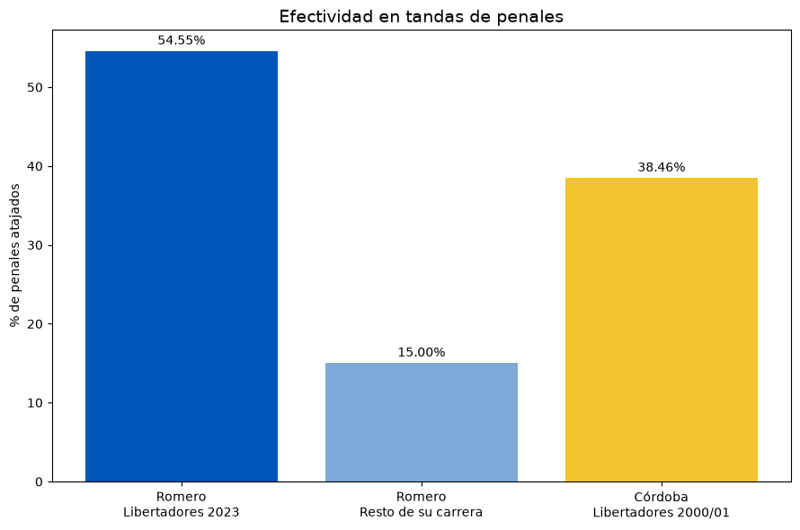
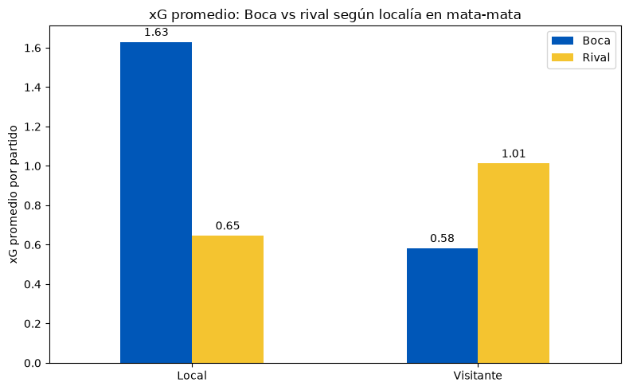
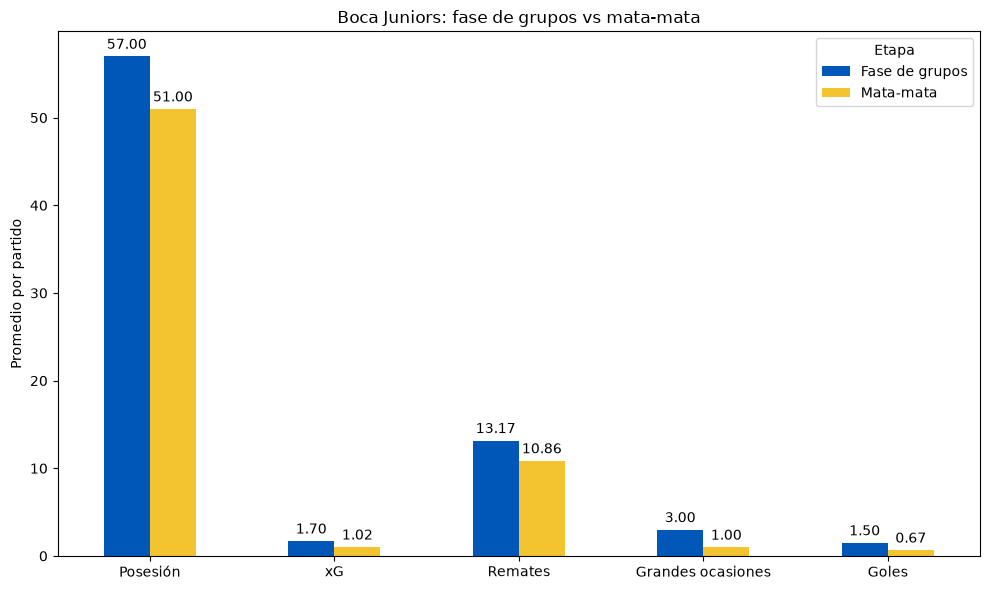

# Boca Juniors en la Copa Libertadores 2023

**¿Cómo llegó Boca a la final de la Libertadores 2023 sin ganar ningún partido de eliminación directa en los 90 minutos?**



## En 30 segundos

- **Romero fue el factor más extraordinario:** atajó 6 de 11 penales en tandas (54,55%). Según su historial previo (15,79%), la probabilidad de lograrlo era de **0,348%** con un modelo binomial.
- **Boca bajó su producción en el mata-mata:** el xG por partido cayó de **1,70** en la fase de grupos a **1,02** en las eliminatorias.
- **Hubo dos Bocas según la localía:** en la Bombonera generó **1,63 xG** por partido; de visitante, **0,58**, con 4 remates por partido.



## Qué muestra este proyecto

- Descarga de datos de FotMob y SofaScore con LanusStats, y scraping de tablas de El Gráfico.
- Limpieza y armado de un dataset propio por partido: [`data/partidos_boca_2023_completo.csv`](data/partidos_boca_2023_completo.csv).
- Análisis comparativo con pandas, visualización con matplotlib y mplsoccer, y un modelo probabilístico con scipy.
- Conclusiones escritas y respaldadas con números.

## Cómo está armado el dataset

Cada fila es la estadística de un equipo en un partido de Boca (13 partidos, 26 filas). Las estadísticas se descargan de FotMob con LanusStats a partir del identificador de cada partido, y se completan con los goles del detalle del partido. Los datos de jugadores y formaciones salen de las alineaciones de FotMob, y el historial de penales de Romero, de una tabla publicada por El Gráfico.

## Cómo reproducirlo

```bash
git clone https://github.com/PepiGercek/boca-libertadores-2023-analysis.git
cd boca-libertadores-2023-analysis
python -m venv .venv
.venv\Scripts\activate        # Windows (en Linux o macOS: source .venv/bin/activate)
pip install -r requirements.txt
jupyter notebook analisis_boca_libertadores_2023.ipynb
```

Algunas celdas consultan FotMob, SofaScore y El Gráfico en vivo, así que los resultados dependen de que esas fuentes sigan disponibles.

## Estructura

```
analisis_boca_libertadores_2023.ipynb   análisis completo
data/partidos_boca_2023_completo.csv    estadísticas por partido
reports/                                gráficos exportados del notebook
```

## Fuentes de datos

- FotMob
- SofaScore
- LanusStats
- El Gráfico, para el historial de penales de Sergio Romero

## Herramientas

- Python
- pandas
- matplotlib
- mplsoccer
- scipy
- LanusStats

## Principales hallazgos

- Boca redujo considerablemente su producción ofensiva entre la fase de grupos y el mata-mata.
- El equipo mostró una diferencia muy marcada según la localía: fue más dominante en la Bombonera y mucho más reactivo como visitante.
- Las series frente a Nacional, Racing y Palmeiras tuvieron desarrollos diferentes, por lo que no existió una única fórmula para llegar a los penales.
- Sergio Romero fue el factor diferencial más extraordinario de las eliminatorias: atajó 6 de 11 penales en tandas, un 54,55%.
- En el resto de las tandas de su carrera su efectividad fue del 15%.
- Usando únicamente su rendimiento histórico previo a la Copa, la probabilidad estimada de atajar al menos 6 de 11 penales fue de aproximadamente 0,348% bajo un modelo binomial.
- En comparación, Óscar Córdoba atajó 5 de 13 penales en las tandas de las Libertadores campeonas de 2000 y 2001.
- La final contra Fluminense mostró nuevamente dificultades de Boca para transformar volumen de juego en ocasiones claras, mientras el campeón fue más eficiente en momentos decisivos.

## Conclusión

Boca Juniors llegó a la final de la Copa Libertadores 2023 sin ganar ninguno de sus seis partidos de octavos, cuartos y semifinales en los 90 minutos. Sin embargo, los datos muestran que reducir ese recorrido a "Boca se defendió y ganó por penales" sería una simplificación.

El principal cambio apareció entre la fase de grupos y el mata-mata. Boca pasó de una etapa en la que mostró una superioridad ofensiva clara a eliminatorias mucho más equilibradas. Su xG promedio cayó de 1,70 a 1,02, los remates de 13,17 a 10,86 y los goles de 1,50 a 0,57 por partido. La producción ofensiva disminuyó considerablemente, mientras que el xG generado por sus rivales prácticamente no aumentó.

También apareció uno de los patrones más fuertes de todo el análisis: **la localía modificó completamente el comportamiento del equipo**.

En la Bombonera, Boca promedió 59% de posesión, 1,63 xG y 16,33 remates por partido. Tuvo más xG y más remates que su rival en los tres encuentros disputados como local.

Como visitante, el escenario fue prácticamente opuesto: 44,33% de posesión, apenas 0,58 xG y 4 remates por partido. Los despejes aumentaron de 8,33 como local a 27,67 como visitante. Boca pasó de intentar dominar los partidos en casa a adoptar un comportamiento mucho más reactivo fuera de ella.

A pesar de estos cambios, las tres series frente a Nacional, Racing y Palmeiras llegaron a los penales. Allí apareció el factor más extraordinario de toda la campaña: **Sergio Romero**.

Romero enfrentó 11 penales en las tres tandas y atajó 6, alcanzando una efectividad del **54,55%**. En el resto de las tandas de su carrera había atajado aproximadamente el 15%. Incluso tomando solamente su rendimiento previo a la Libertadores 2023 (15,79%), un modelo binomial estima en aproximadamente **0,348%** la probabilidad de atajar al menos 6 de 11 penales.

Su rendimiento fue excepcional incluso en comparación con antecedentes históricos de Boca: Óscar Córdoba atajó 5 de 13 penales (38,46%) en las tandas disputadas durante las Libertadores campeonas de 2000 y 2001.

Esto no significa que Romero haya sostenido permanentemente al equipo durante los partidos. Sus estadísticas de atajadas y goles evitados durante el juego fueron mucho menos extraordinarias. Su verdadero impacto diferencial apareció cuando las series llegaron al escenario específico de las definiciones por penales.

La final frente a Fluminense volvió a mostrar las principales fortalezas y limitaciones de Boca. El equipo consiguió sobrevivir a un primer tiempo dominado territorialmente por Fluminense y equilibró considerablemente el segundo, pero siguió teniendo dificultades para generar ocasiones claras. El empate llegó mediante Luis Advíncula, un defensor que terminó siendo el máximo goleador de Boca en la competición con cuatro tantos.

Fluminense, en cambio, encontró sus goles a través de sus principales armas ofensivas: Germán Cano, goleador del torneo, y John Kennedy, que ya habían sido decisivos en la semifinal frente a Internacional. En un partido de producción ofensiva relativamente baja, el conjunto brasileño terminó siendo más eficiente en los momentos determinantes.

En definitiva, **Boca llegó a la final porque fue un equipo extremadamente difícil de eliminar, adaptable al contexto y capaz de mantenerse competitivo aun cuando su producción ofensiva disminuyó**. No dominó todas las series ni fue permanentemente dominado.

Su recorrido se construyó mediante partidos cerrados, una marcada adaptación a la localía, aportes individuales importantes y una ventaja extraordinaria cuando los cruces llegaron a los penales.

Ese último factor tuvo nombre propio: **Sergio Romero**.

La combinación fue suficiente para alcanzar la final. Frente a Fluminense, la mayor eficacia ofensiva del campeón terminó rompiendo un equilibrio que Boca había conseguido sostener durante prácticamente todo el mata-mata.

## Notebook

El análisis completo, con la preparación de datos, las métricas, las visualizaciones y las conclusiones, está en [`analisis_boca_libertadores_2023.ipynb`](analisis_boca_libertadores_2023.ipynb).


